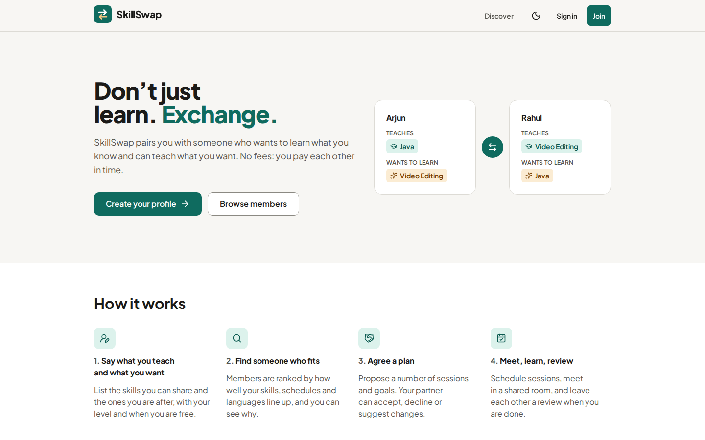
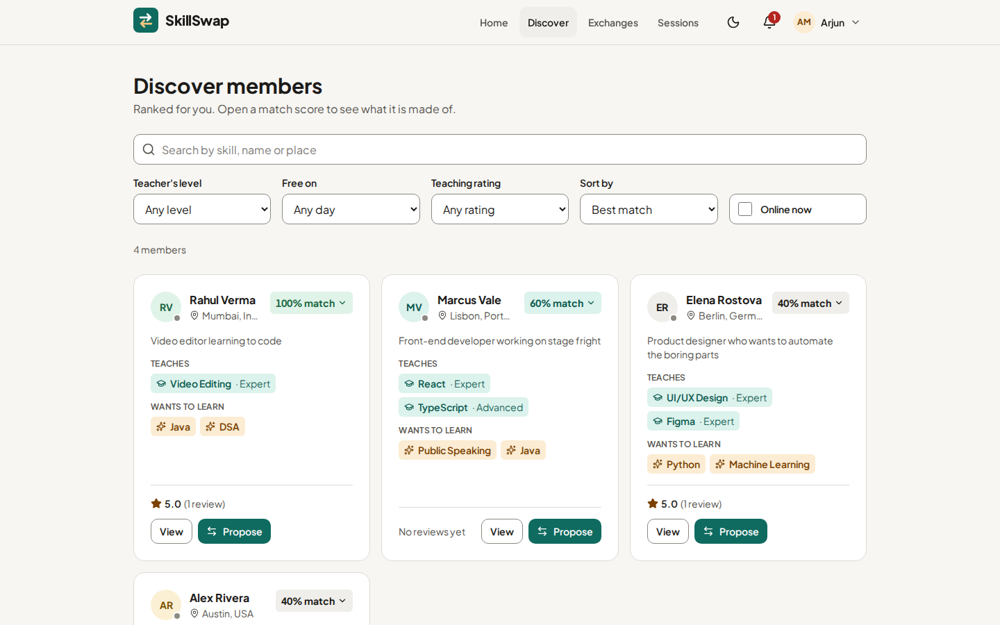
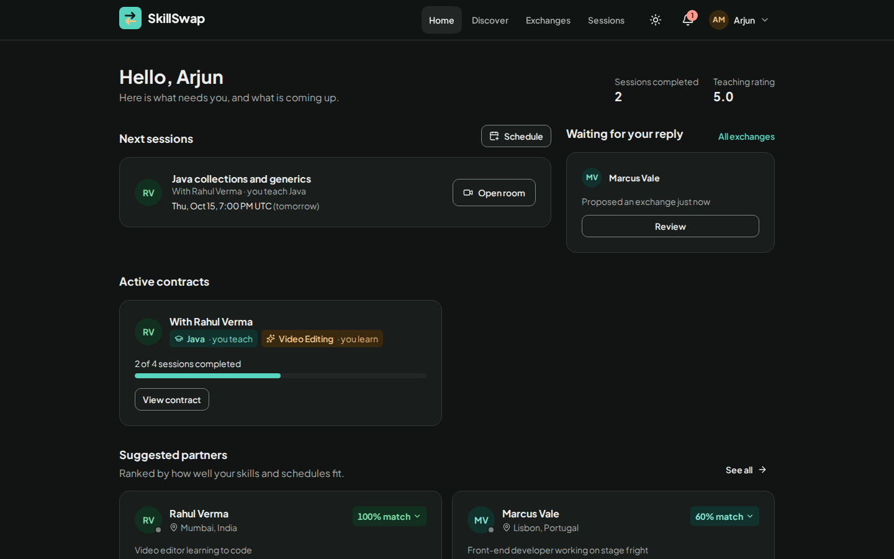
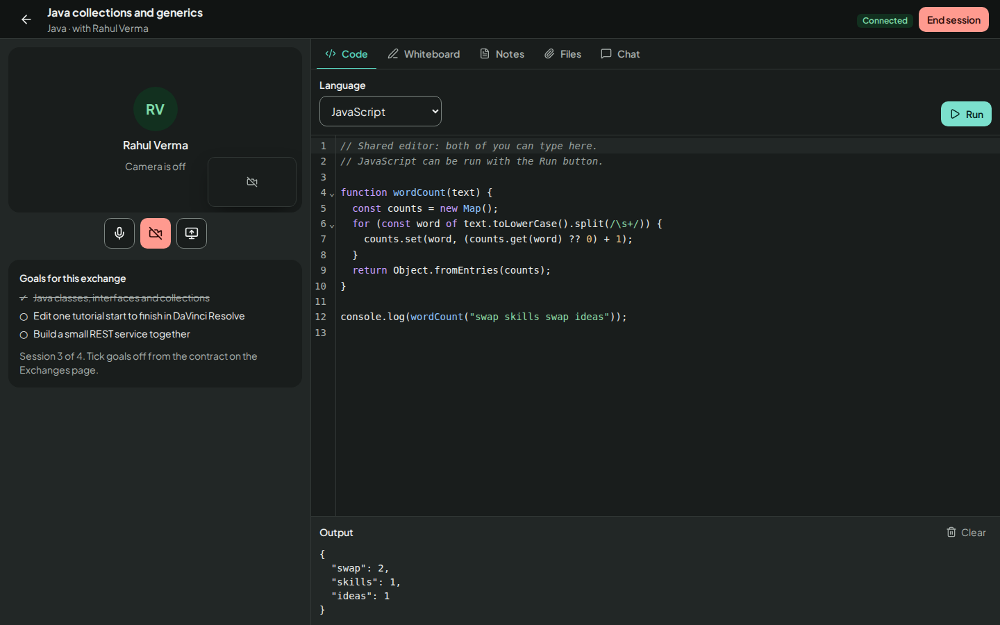
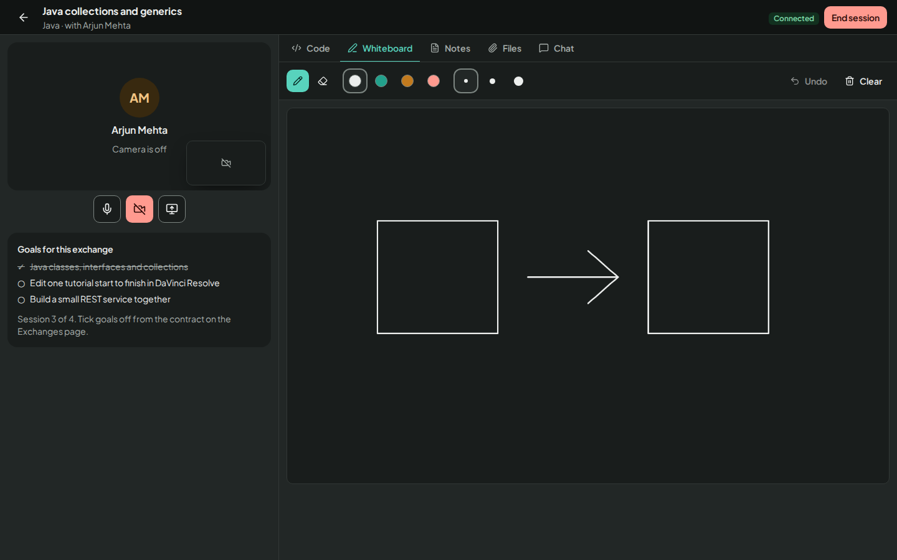
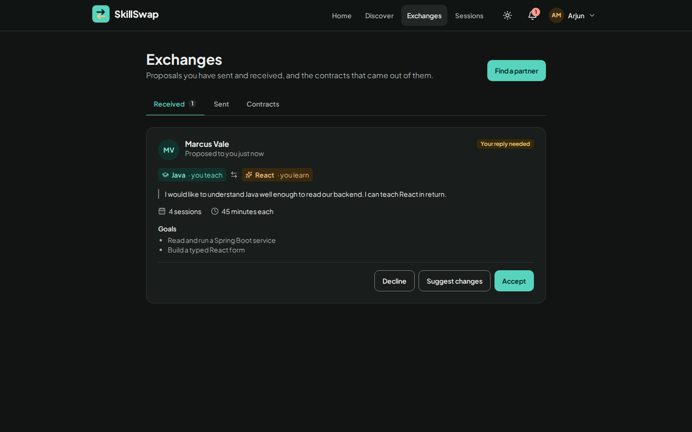
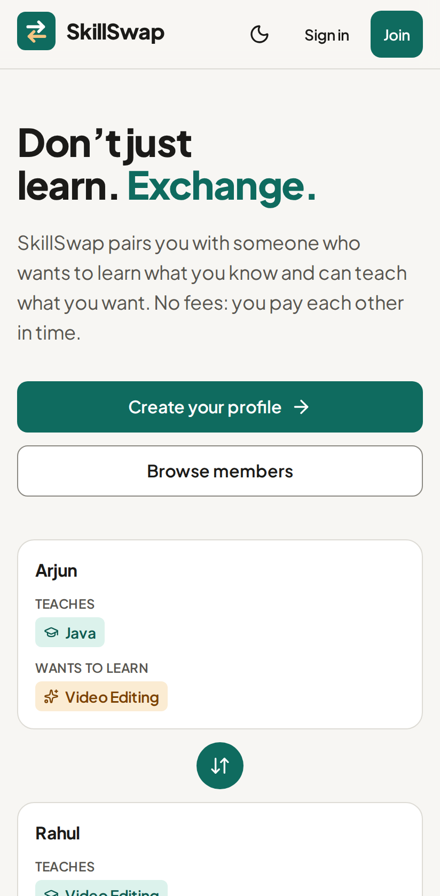
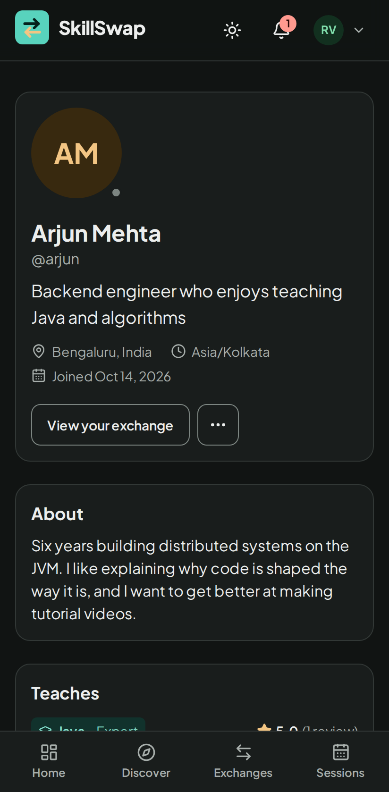

<div align="center">


# SkillSwap

**Don't just learn. Exchange.**

A peer-to-peer skill exchange: list what you can teach and what you want to learn, get matched with
someone who fits, agree a plan, and meet in a shared learning room. Nobody pays; each side teaches
the other.

[](https://github.com/Arvin-Arun-Dcosta/SkillSwap/actions/workflows/ci.yml)


[](LICENSE)



</div>

## Features

- **Matching that explains itself.** Members are ranked by how well skills, schedules, levels,
  languages and session preferences line up. Open any score to see what it is made of.
- **Negotiated exchanges.** Propose a swap with a number of sessions and goals; your partner can
  accept, decline or suggest changes. Accepting creates a contract you schedule sessions against.
- **A real learning room.** Peer-to-peer video and screen sharing, a shared code editor that runs
  JavaScript in a sandbox, a whiteboard, notes, file sharing and chat. Everything syncs live and is
  saved automatically.
- **Honest reputation.** Ratings come only from reviews of sessions both members actually attended.
  New members show "No reviews yet", never an invented number.
- **Moderation.** Members can report profiles; admins get a queue and live platform statistics.
- **Accessible on every screen.** Light and dark themes, keyboard support throughout, phone layouts
  for every page, and WCAG 2.2 AA checks in CI.

## Screenshots

<table>
  <tr>
    <td width="50%"></td>
    <td width="50%"></td>
  </tr>
  <tr>
    <td align="center"><b>Discover</b>: ranked matches with filters</td>
    <td align="center"><b>Dashboard</b>: what needs you, in dark mode</td>
  </tr>
  <tr>
    <td></td>
    <td></td>
  </tr>
  <tr>
    <td align="center"><b>Learning room</b>: shared editor with a sandboxed runner</td>
    <td align="center"><b>Whiteboard</b>: your partner's drawing, live</td>
  </tr>
  <tr>
    <td colspan="2"></td>
  </tr>
  <tr>
    <td colspan="2" align="center"><b>Exchanges</b>: accept, decline or counter a proposal</td>
  </tr>
</table>

<p align="center">
  
  &nbsp;&nbsp;
  
</p>

## Quick start

Requirements: **Node.js 22.12 or newer** and npm. Nothing else.

```bash
npm install
npm run dev
```

Open <http://localhost:5173>.

With no configuration the API starts its own in-memory MongoDB, seeds demo data and turns on demo
sign-in, so you can click a demo member on the sign-in page and look around. Open a second browser
(or a private window) as their partner to try a session from both sides: Arjun and Rahul share
the room `SWAP-DEMO-ROOM`.

The first run downloads a MongoDB binary (about 120 MB) for the in-memory database. Data in this mode
is lost when the server stops. To keep data, point the app at a real MongoDB:

```bash
cp .env.example .env            # then set MONGODB_URI
docker compose up -d mongo      # optional: a local MongoDB on 127.0.0.1:27017
npm run seed                    # optional: demo data in that database
npm run dev
```

Demo accounts created by the seed script: `arjun`, `rahul`, `alex`, `elena`, `marcus`, `admin`,
all with the password `Password123!`. They are flagged as demo accounts; do not seed a database that
real people use.

## Tech stack

| Layer | Built with |
| --- | --- |
| Client | React 19, Vite 8, Tailwind CSS 4, TanStack Query, React Router 7, react-hook-form, CodeMirror 6 |
| Server | Node.js 22+, Express 5, Mongoose 9 (MongoDB), Socket.IO, pino |
| Real time | WebRTC (peer-to-peer calls), Yjs (conflict-free shared editing) |
| Shared | TypeScript (strict) and zod schemas used by both client and server |
| Quality | Vitest, Playwright, axe-core, ESLint, Prettier, GitHub Actions |

## Scripts

Run from the repository root.

| Command | What it does |
| --- | --- |
| `npm run dev` | API on :5000 and client on :5173, both reloading on change |
| `npm run build` | Builds the client (`client/dist`) and bundles the server (`server/dist/index.js`) |
| `npm start` | Runs the built server, which also serves the built client |
| `npm run lint` / `npm run lint:fix` | ESLint (type-aware, React hooks, accessibility rules) |
| `npm run format` / `npm run format:check` | Prettier |
| `npm run typecheck` | TypeScript in every workspace |
| `npm test` | Unit and API integration tests (Vitest, in-memory MongoDB) |
| `npm run e2e` | Playwright end-to-end tests against the built app (run `npm run build` first) |
| `npm run check` | lint, format check, typecheck, tests and build: what CI runs |
| `npm run seed [-- --reset]` | Seeds demo data into `MONGODB_URI` (`--reset` deletes existing data first) |
| `npm run migrate` | Upgrades a database created by the 1.0 prototype in place (back it up first) |

First e2e run on a new machine: `npx playwright install chromium` inside `e2e/`.

## Configuration

The server reads `.env` from the repository root and refuses to start when something is invalid.
The client needs no build-time variables. `.env.example` documents every setting.

| Variable | Default | Notes |
| --- | --- | --- |
| `NODE_ENV` | `development` | `production` switches on strict requirements below |
| `PORT` | `5000` | API port; in production also serves the client |
| `MONGODB_URI` | empty | **Required in production.** Empty in development means in-memory MongoDB with demo data |
| `JWT_SECRET` | random per run in development | **Required in production**, at least 32 characters (`openssl rand -base64 48`) |
| `SESSION_DAYS` | `7` | Lifetime of the sign-in cookie |
| `CLIENT_ORIGINS` | `http://localhost:5173` | Origins allowed to send credentialed requests, comma separated |
| `PUBLIC_URL` | empty | Public base URL. Used for sitemap and share links; `https://…` also enables HSTS |
| `DEMO_MODE` | on in development, off in production | One-click sign-in for seeded demo accounts |
| `SEED_DEMO_DATA` | `false` | Seed demo data at startup when the database has no members |
| `DEMO_RESET_HOURS` | `0` (never) | Public demos: wipe everything and re-seed once the demo data is this old |
| `ICE_SERVERS` | Google STUN | JSON array; add a TURN server for calls across strict NATs |
| `UPLOAD_DIR` | `./server/uploads` | Where shared session files are stored |
| `MAX_UPLOAD_MB` | `10` | Size limit per shared file |
| `TRUST_PROXY` | `false` | Set `true` behind a reverse proxy, or rate limiting sees one client |
| `COOKIE_SECURE` | on in production | Cookie over HTTPS only |
| `LOG_LEVEL` | `debug` in development, `info` in production | pino levels |

## Architecture

```
shared/   zod schemas, constants and TypeScript types used by both sides
server/   Express 5 API, Socket.IO real-time layer, Mongoose models; serves the built client
client/   React 19 single-page app (Vite, Tailwind CSS 4, TanStack Query, React Router)
e2e/      Playwright tests that drive the built application
```

One Node process serves the REST API under `/api`, the WebSocket endpoint under `/socket.io` and the
static client, in front of MongoDB. In development Vite serves the client and proxies those two paths.

```
Browser ──HTTP──▶ Express ──▶ routes ──▶ services ──▶ Mongoose ──▶ MongoDB
   │                 ▲
   ├──WebSocket──▶ Socket.IO (presence, room membership, chat, call signalling, shared document)
   └──WebRTC─────▶ the other participant's browser (audio, video, screen: peer to peer)
```

<details>
<summary><b>Server</b> (<code>server/src</code>)</summary>

- `config/` validates the environment and sets up structured logging (pino, request ids).
- `routes/` parse input with the shared zod schemas and call `services/`, which hold the rules:
  who may do what, state transitions, and notifications. `serializers.ts` is the only place database
  documents become API responses, so private fields cannot leak by accident.
- `middleware/` covers sessions (signed, `httpOnly` cookie with server-side revocation), the origin
  check for state-changing requests, rate limits, security headers and the single error format
  `{ "error": { "code", "message", "fields?", "requestId" } }`.
- `realtime/` authenticates every socket from the session cookie, admits only a session's two
  participants to its room, relays call signalling and chat, and keeps one Yjs document per open
  session (code, notes, whiteboard) that it merges, persists and hands to late joiners.
- `web.ts` serves the client with long-lived caching and precompressed (brotli, gzip) hashed assets,
  real 404s, `robots.txt`, a sitemap, and per-profile titles and descriptions for link previews.

</details>

<details>
<summary><b>Client</b> (<code>client/src</code>)</summary>

- `components/ui/` is the design system: buttons, fields, dialogs (native `<dialog>`), tabs, menus,
  toasts, loading/empty/error states. Colours come from tokens in `styles/index.css` with light and
  dark values; a unit test checks the contrast of every pairing.
- `features/` holds auth, the socket connection and the profile forms; `pages/` one file per route;
  `room/` the learning room (call, editor, whiteboard, notes, files, chat, code sandbox).
- Server state lives in TanStack Query; pages behind sign-in are code-split.

</details>

<details>
<summary><b>How the rules work</b></summary>

- A match score is the sum of five parts (skills 50, availability 20, level 10, language 10,
  preferences 10). Nothing in common scores zero. See `server/src/services/matching.ts`.
- An exchange moves `PENDING → COUNTERED ⇄ COUNTERED → ACCEPTED → COMPLETED`, or to `REJECTED` /
  `CANCELLED`. Only the member who did not make the latest offer can accept it. Accepting creates a
  contract; sessions are then scheduled explicitly, up to the agreed number.
- A session counts as completed only if both members entered the room. Each member can then leave
  one review; ratings are recomputed from stored reviews.
- Code in the shared editor runs in a sandboxed iframe with an opaque origin and no network access.
  Only JavaScript can be run.

</details>

## Deploying

SkillSwap needs one Node 22+ process and a MongoDB database. A reverse proxy must forward WebSocket
upgrades for `/socket.io`.

**With Docker**

```bash
export JWT_SECRET=$(openssl rand -base64 48)
export PUBLIC_URL=https://skillswap.example        # your public address
docker compose --profile app up --build -d
```

This runs MongoDB and the app (port 5000) with volumes for data and uploads. Put a TLS-terminating
proxy in front and set `TRUST_PROXY=true`.

For a public demo instead, add `DEMO_MODE=true SEED_DEMO_DATA=true DEMO_RESET_HOURS=24` to the
environment: the empty database is seeded at startup and wiped and re-seeded once a day. Never do
this with a database real members use.

**Without Docker**

```bash
npm ci
npm run build
NODE_ENV=production MONGODB_URI=… JWT_SECRET=… PUBLIC_URL=https://… TRUST_PROXY=true npm start
```

**Checklist**

1. `JWT_SECRET` is random and private; `MONGODB_URI` points at a database with backups.
2. `PUBLIC_URL` is the HTTPS address users see; `TRUST_PROXY=true` behind a proxy.
3. `DEMO_MODE` is unset or `false`, and the seed script has not been run against this database.
4. `UPLOAD_DIR` is on persistent storage.
5. Point health checks at `/api/health/ready` (database reachable) and `/api/health` (process alive).
6. For reliable calls on restrictive networks, add a TURN server to `ICE_SERVERS`.

The process handles `SIGTERM` by saving open shared documents and closing connections before exit.
It keeps room state in memory, so run a single instance (scaling out needs a Socket.IO adapter and
shared document storage).

## Testing

- `npm test`: 200+ unit and integration tests. The server suite runs the real Express app and
  Socket.IO server against an in-memory MongoDB, including security regression tests and a migration
  test on 1.0-shaped data.
- `npm run e2e`: two real browsers negotiate an exchange, hold a WebRTC call with generated camera
  streams, edit code and notes together, end the session and review each other. Every page is also
  checked at desktop and phone size for layout overflow, console errors and WCAG 2.2 AA rules (axe).

## Project documents

| File | Contents |
| --- | --- |
| [`CHANGELOG.md`](CHANGELOG.md) | Release notes |
| [`CLAUDE.md`](CLAUDE.md) | Conventions and gotchas for people and coding agents working in this repository |

## License

[MIT](LICENSE) © Arvin Arun Dcosta
